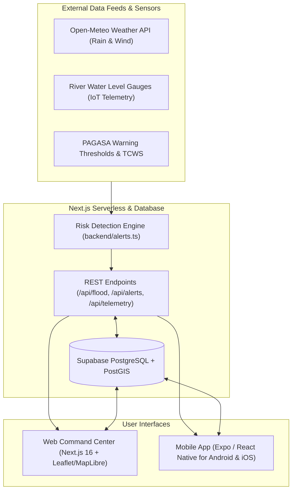

# AgapAlert (mob-agap) — Project Overview, Feature Specification & Valuation Report

**Document Version:** 1.0  
**Project Name:** AgapAlert (`mob-agap`)  
**Target Platforms:** Web (Next.js 16 / React 19) & Mobile (Expo / React Native)  
**Currency:** Philippine Peso (PHP / ₱)  

---

## Executive Summary

**AgapAlert** is a full-stack, multi-platform Disaster Risk Reduction and Management (DRRM) and Hydrological Flood Early Warning System designed for Philippine communities and Local Government Units (LGUs). It combines real-time meteorological observations, river gauge telemetry, PAGASA-standard risk classifications, GIS mapping, and geo-targeted alerts into a single unified ecosystem.

---

## System Architecture & Tech Stack

### Technology Matrix

| Layer | Technologies & Frameworks |
| :--- | :--- |
| **Mobile Application** | React Native (0.86), Expo (57), `react-native-maps`, `react-native-webview`, `expo-location`, `expo-notifications`, Lucide Icons |
| **Web Application** | Next.js 16, React 19, Tailwind CSS, Leaflet, MapLibre GL, Lucide React, Shadcn/Radix UI |
| **Backend & APIs** | Next.js Route Handlers (Edge & Node.js runtime), TypeScript, Geo-spatial algorithms |
| **Database & Auth** | Supabase (PostgreSQL 15+, `pgcrypto`, PostGIS spatial queries, Row Level Security) |
| **Data Providers** | Open-Meteo, PAGASA Warning Protocol standard, OpenStreetMap tile servers |

---

## Detailed Feature List

### 1. Hydrological & Meteorological Risk Engine
* **Automated Risk Scoring (0–100 Scale)**:
  * Computes overall disaster threat score categorized into: **Minimal**, **Low**, **Moderate**, **High**, and **Critical (Mandatory Evacuation)**.
* **Dual-Risk Probability Calculations**:
  * **Flash Flood Probability (0–100%)**: Evaluated using instantaneous rainfall intensity, soil saturation index, and topography.
  * **River Overflow Probability (0–100%)**: Evaluated from upstream basin rainfall accumulation and sensor water level vs. bankfull thresholds.
* **PAGASA Color-Coded Rainfall Warning Classification**:
  * **Yellow Warning (7.5–15 mm/h)**: Advisory alert; flooding possible in low-lying areas.
  * **Orange Warning (15–30 mm/h)**: Threatening flood; prepare Go-Bags and evacuation plan.
  * **Red Warning (>30 mm/h)**: Torrential rainfall; mandatory evacuation directive.
* **Tropical Cyclone Wind Signal (TCWS 1 to 5)**:
  * Real-time storm signal parsing, wind speed tracking (km/h), and peak gust monitoring.
* **River Sensor Telemetry Pipeline**:
  * Integrates monitoring stations (e.g., Sinocalan River Basin in Pangasinan, Marikina River, Bicol Basin, Cagayan River).
  * Tracks live water level (meters), rate of rise ($m/h$), and trend (*Rising*, *Stable*, *Falling*).

---

### 2. Cross-Platform Mobile Application (iOS & Android)
* **Real-Time Disaster Radar Screen**:
  * Live status badge, localized rainfall meter, river level gauges, and active storm signal display.
  * Auto-detects resident coordinates via GPS or allows selecting regional presets.
* **Interactive Disaster & Hazard Map**:
  * Visualizes nearby river sensors, verified flood zones, and designated evacuation centers.
  * Provides one-tap directions via external navigation apps (Google Maps / Waze).
* **Push Notification Subscriptions**:
  * Geofenced alerts matching the user's specific coordinates and customizable distance radius (e.g., within 5–50 km).
  * Severity filtering (advisories, watches, or critical alerts only).
* **Siren & Auditory Warning Trigger**:
  * In-app emergency sound alert for urgent flood level breaches.
* **Emergency Hotlines Directory & Go-Bag Guide**:
  * Quick-dial buttons for NDRRMC, PAGASA, PNP, BFP, Coast Guard, Red Cross, and local MDRRMO.
  * Interactive offline-ready checklist for disaster kit preparation.

---

### 3. Web Command Center & LGU Management Portal
* **Role-Based Access Control (RBAC)**:
  * **Resident Portal**: View danger levels, locate safe zones, submit incident reports.
  * **Official / MDRRMO Command Center**: Broadcast emergency advisories, dispatch responders, manage shelters.
* **Evacuation Center Capacity Management**:
  * Live tracker for total capacity vs. current evacuee occupancy count.
  * Facility status indicators (Potable water, Food packs, Medical post, Standby generator).
* **Citizen Incident & Rescue Dispatch Tracking**:
  * Crowdsourced reports with flood depth, stranded headcount, fallen powerlines, and blocked roads.
  * Official verification workflow (*Pending*, *Verified*, *Resolved*).

---

### 4. Database Architecture & Data Models
* **`alerts`**: Stores issued meteorological and hydrological warnings with unique fingerprinting to prevent duplicates.
* **`alert_subscriptions`**: Stores device push tokens, coordinates (lat/long), radius constraints, and alert preferences.
* **`alert_deliveries`**: Tracks delivery status, timestamps, and provider ticket IDs.
* **`river_monitoring_stations`**: Catalogs station telemetry, normal/alert/critical meter thresholds, and delta rates.
* **`sensor_telemetry_readings`**: High-frequency time-series table for IoT rain gauges, water levels, and soil moisture sensors.

---

## Valuation & Cost Breakdown (Philippine Peso — PHP)

### A. Custom Software Development Cost (Market Value)
*Estimated cost if developed by an IT agency or software engineering team in the Philippines:*

| Module / Scope | Scope Details | Estimated Value (PHP) |
| :--- | :--- | :--- |
| **Mobile Application** | React Native (Expo) iOS/Android app, push notifications, GPS, sound alerts, offline cache | ₱150,000 – ₱230,000 |
| **Web Command Center** | Next.js 16, React 19, responsive layout, GIS mapping, LGU Admin console | ₱120,000 – ₱180,000 |
| **Hydrological Risk Engine & APIs** | PAGASA logic, multi-factor algorithms, Open-Meteo pipeline, telemetry endpoints | ₱70,000 – ₱120,000 |
| **Database & Auth (Supabase)** | PostgreSQL schema, PostGIS spatial queries, RLS security, real-time channels | ₱40,000 – ₱70,000 |
| **UI/UX Design & System Branding** | High-fidelity dark mode disaster UI design, interactive component library | ₱40,000 – ₱60,000 |
| **QA Testing & Deployment** | Multi-device QA, simulated disaster stress testing, App Store / Play Store setup | ₱30,000 – ₱50,000 |
| **Total Development Value** | | **₱450,000 – ₱710,000 PHP** |

---

### B. Recurring Operational & Infrastructure Costs (Monthly)

| Service / Resource | Provider & Tier | Estimated Monthly Cost (PHP) |
| :--- | :--- | :--- |
| **Database & Authentication** | Supabase (Free Tier or Pro @ $25/mo) | ₱0 – ₱1,450 / mo |
| **Web Dashboard Hosting** | Vercel / Cloudflare (Free Tier or Pro @ $20/mo) | ₱0 – ₱1,160 / mo |
| **Push Notification Service** | Expo Application Services (EAS) Free Tier | ₱0 / mo |
| **Weather & Map Data Feeds** | Open-Meteo & OpenStreetMap (Free non-commercial) | ₱0 / mo |
| **SMS Alert Gateway (Optional)** | Local PH Gateway (Semaphore @ ~₱0.50/SMS) | ₱500 – ₱2,500 / mo |
| **App Developer Licenses** | Apple Developer ($99/yr) + Google Play ($25 one-time) | ~₱500 / mo *(amortized)* |
| **Total Monthly Running Cost** | | **₱0 (Dev / Free tier)** **₱2,500 – ₱6,000 PHP / mo (Production)** |

---

### C. Commercial / Government (LGU) Procurement Pricing
*Standard pricing models for local Philippine government contracts (MDRRMO / PDRRMO):*

* **Turnkey LGU Package (Per Municipality/City):**
  * **₱600,000 – ₱1,500,000 PHP** (Includes customized local branding, integration with municipal IoT water level sensors, MDRRMO staff training, and 1-year maintenance support).
* **SaaS / Managed Cloud Subscription Model:**
  * **₱15,000 – ₱35,000 PHP / month** per LGU for continuous automated risk feeds, hosted command center, database management, and emergency broadcast capabilities.

---

*Report generated for AgapAlert Project Management & Stakeholder Review.*
