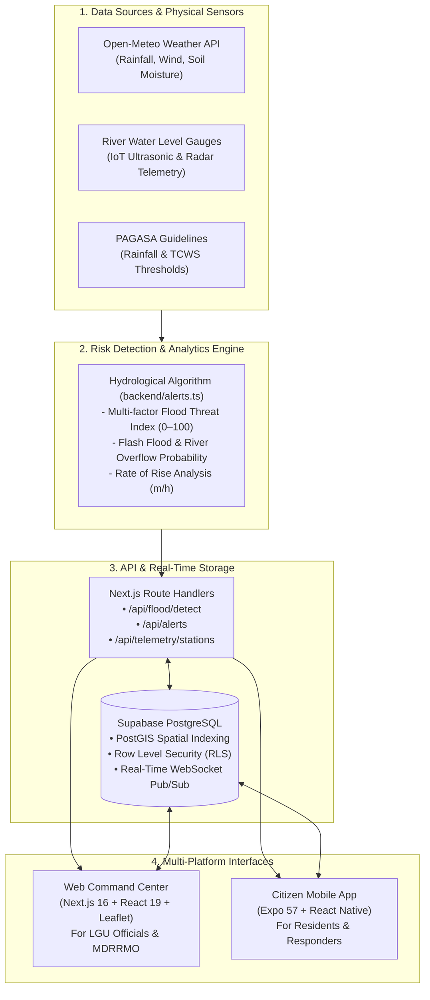

# AgapAlert (mob-agap)
### Intelligent Disaster Risk Reduction & Hydrological Early Warning System
**Compliant with Republic Act No. 10121 (Philippine Disaster Risk Reduction and Management Act) & PAGASA Warning Standards**

[](https://nextjs.org/)
[](https://react.dev/)
[](https://reactnative.dev/)
[](https://expo.dev/)
[](https://supabase.com/)
[](LICENSE)

---

## 1. Executive Summary

**AgapAlert** is a full-stack, multi-platform disaster risk management ecosystem designed for Philippine Local Government Units (LGUs), Municipal Disaster Risk Reduction and Management Offices (MDRRMOs), and vulnerable riverbank communities.

In typhoon-prone regions such as the **Sinocalan River Basin in Pangasinan** and the **Marikina River Basin in Metro Manila**, community flood warnings frequently suffer from information delays, fragmented evacuation center records, and lack of real-time sensor integration.

AgapAlert bridges this critical gap by fusing:
1. **Live Meteorological Feeds** (precipitation accumulation, instantaneous rain intensity, wind speeds, and soil saturation via Open-Meteo).
2. **Automated River Gauge Telemetry** (water elevation in meters, rate of rise in $m/h$, and alert/critical threshold breaches).
3. **PAGASA Standard Classification** (Color-coded Rainfall Warnings: Yellow, Orange, Red; Tropical Cyclone Wind Signals: TCWS 1–5).
4. **Dual Client Applications**:
   - **Web Command Center**: Incident command, shelter occupancy tracking, relief inventory monitoring, and official alert broadcast.
   - **Citizen Mobile App**: Real-time localized disaster radar, emergency sirens, interactive evacuation navigation (Waze / Google Maps), and offline hotlines.

---

## 2. System Architecture



---

## 3. Core Algorithmic Framework

### A. Multi-Factor Flood Risk Scoring (0–100 Scale)
AgapAlert computes an objective threat index synthesized from four environmental vectors:
$$\text{Risk Score} = w_1 \cdot S_{\text{rain}} + w_2 \cdot S_{\text{accum}} + w_3 \cdot S_{\text{river}} + w_4 \cdot S_{\text{soil}}$$

* **Instantaneous Rain Rate ($S_{\text{rain}}$)**: Scaled against PAGASA torrential threshold ($>30\text{ mm/h}$).
* **24-Hour Accumulation ($S_{\text{accum}}$)**: Evaluates catchment saturation and upstream drainage load.
* **River Gauge Level ($S_{\text{river}}$)**: Compares current stage against Alert and Bankfull Critical meters.
* **Soil Moisture Saturation Index ($S_{\text{soil}}$)**: Informs ground runoff coefficient.

| Threat Category | Score Range | Operational Protocol |
| :--- | :---: | :--- |
| **MINIMAL** | 0 – 19 | Standard ambient conditions; routine monitoring. |
| **LOW** | 20 – 39 | Minor catchment accumulation; advisory stage. |
| **MODERATE** | 40 – 59 | Heightened flood threat; prepare emergency kits and Go-Bags. |
| **HIGH** | 60 – 79 | Preemptive evacuation recommended for low-lying riverbank zones. |
| **CRITICAL** | 80 – 100 | **Mandatory Evacuation Directive**; immediate siren and alert dispatch. |

### B. PAGASA Color-Coded Rainfall Warning Classification
* **YELLOW (7.5 – 15 mm/h)**: *Community Advisory* — Flooding possible in low-lying barangays.
* **ORANGE (15 – 30 mm/h)**: *Threatening Flood* — Evacuation on standby; emergency teams activated.
* **RED (> 30 mm/h)**: *Torrential Disaster* — Severe flooding expected; mandatory immediate evacuation.

---

## 4. Key Modules & Features

| Platform | Capability | Technical Highlights |
| :--- | :--- | :--- |
| **Web Portal** | **GIS Incident Map** | Interactive Leaflet / MapLibre layers displaying river gauges, safe evacuation shelters, and live flood risk overlays. |
| **Web Portal** | **Shelter Management** | Live tracker of total capacity vs. current evacuee occupancy with relief stock level indicators (Drinking water, food packs, medicine). |
| **Web Portal** | **Incident Dispatch** | Citizen crowdsourced incident feed with verification states (*Pending*, *Verified*, *Resolved*). |
| **Mobile App** | **Live Disaster Radar** | Real-time gauge meters, rate of rise indicators, and animated threat level badges. |
| **Mobile App** | **One-Tap Evacuation Navigation** | Calculates distance to nearest open center with direct routing into Google Maps or Waze. |
| **Mobile App** | **Auditory Siren System** | Emergency audio alert trigger with persistent visual banner for critical breaches. |
| **Backend** | **Telemetry Ingestion** | REST endpoints accepting IoT ultrasonic sensor payloads with automated trend detection (*Rising*, *Stable*, *Falling*). |

---

## 5. Technology Matrix

* **Web Framework**: Next.js 16 (App Router), React 19, TypeScript
* **Styling & UI**: Tailwind CSS, Lucide React, Radix UI primitives
* **Mapping**: Leaflet 1.9, MapLibre GL, OpenStreetMap Carto tiles
* **Mobile Framework**: React Native 0.86, Expo 57, Expo Location, Expo Notifications
* **Database & Auth**: Supabase PostgreSQL 15, PostGIS, Row Level Security (RLS)
* **Meteorological Pipeline**: Open-Meteo High-Resolution API

---

## 6. Getting Started & Installation

### Prerequisites
* **Node.js**: v18.18 or higher (v20+ recommended)
* **Package Manager**: npm or yarn
* **Expo Go App** (optional, for running mobile app on physical Android/iOS device)

### A. Web Command Center Setup
```bash
# Navigate to project root
cd mob-agap

# Install dependencies
npm install

# Configure environment variables
# Copy .env.example to .env.local and insert your Supabase credentials (optional for offline demo)
cp .env.example .env.local

# Launch local development server
npm run dev
```
Open **[http://localhost:3000](http://localhost:3000)** in your browser to view the Command Center.

### B. Citizen Mobile App Setup
```bash
# Navigate to mobile subproject
cd mobile

# Install mobile dependencies
npm install

# Start Expo development server
npx expo start
```
Scan the QR code with your camera (iOS) or **Expo Go** (Android) to test the mobile app.

---

## 7. Interactive API Testing Guide

AgapAlert includes built-in live simulation endpoints for demonstration and thesis defense:

### 1. Multi-Factor Flood Risk Detection
```http
GET /api/flood/detect?lat=16.0034&lng=120.3850
```
**Simulate Critical River Breach & Heavy Rain:**
```http
GET /api/flood/detect?lat=16.0034&lng=120.3850&river_level=6.2&rain_rate=32
```

### 2. Active Alerts Filtered by Radius
```http
GET /api/alerts?lat=16.0034&lng=120.3850&radius=25
```

### 3. Ingest Live IoT River Sensor Telemetry
```http
POST /api/telemetry/stations
Content-Type: application/json

{
  "stationId": "sinocalan-sb-01",
  "currentLevelMeters": 6.15,
  "trend": "RISING",
  "rateOfRiseMetersPerHour": 0.32
}
```

---

## 8. Database Setup (Supabase)

To initialize the database in your Supabase project:
1. Open your Supabase Project Dashboard -> **SQL Editor**.
2. Open [`supabase/schema.sql`](supabase/schema.sql).
3. Copy all contents and execute (`Run`).
4. This sets up all 8 core tables, Row Level Security policies, indexes, and initial Philippine seed records.

---

## 9. Project Structure

```text
mob-agap/
├── app/
│   ├── api/
│   │   ├── alerts/route.ts          # Geo-filtered emergency alerts endpoint
│   │   ├── flood/detect/route.ts    # Hydrological flood risk calculation engine
│   │   └── telemetry/stations/      # River sensor telemetry ingestion
│   ├── globals.css                  # Global Tailwind styling & CSS tokens
│   ├── layout.tsx                   # Next.js root layout with metadata
│   └── page.tsx                     # Web Command Center (Radar, Shelters, Incidents)
├── backend/
│   ├── alerts.ts                    # Core hydrological algorithms & PAGASA logic
│   └── schema.sql                   # Telemetry & alerts subsystem schema reference
├── components/
│   ├── InteractiveMap.tsx           # Full-featured GIS Leaflet disaster map
│   └── ui/                          # Reusable UI component primitives
├── lib/
│   ├── audio.ts                     # Web Audio API emergency siren synthesizer
│   ├── supabase.ts                  # Supabase client configuration & types
│   └── utils.ts                     # Utility helpers
├── mobile/
│   ├── app.json                     # Expo configuration (AgapAlert branded)
│   ├── App.tsx                      # Citizen mobile application main screen
│   ├── components/
│   │   └── MobileGoogleMap.tsx      # Mobile map rendering component
│   ├── notifications.ts             # Push notification subscription handler
│   └── supabase.ts                  # Mobile Supabase client configuration
├── supabase/
│   └── schema.sql                   # Master unified database schema (PostgreSQL)
├── package.json                     # Web application manifest
└── README.md                        # Project documentation & presentation guide
```

---

## 10. Research & Academic Attribution

AgapAlert was developed in accordance with Philippine DRRM guidelines and protocols established by:
* **NDRRMC**: National Disaster Risk Reduction and Management Council
* **DOST-PAGASA**: Philippine Atmospheric, Geophysical and Astronomical Services Administration
* **MDRRMO**: Municipal Disaster Risk Reduction and Management Office (Santa Barbara, Pangasinan)
* **Republic Act 10121**: Philippine Disaster Risk Reduction and Management Act of 2010
